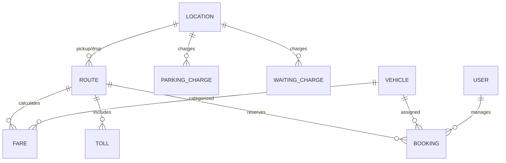

# AJ Travels — Comprehensive Project Documentation & Architecture Guide

Welcome to the comprehensive technical and operational documentation for the **AJ Travels (AJ Tours & Travels Pune)** platform. This document serves as the master reference guide for developers, system administrators, and stakeholders to understand, maintain, extend, and deploy the application without breaking any business or pricing logic.

---

## Table of Contents
1. [Executive Overview & Business Purpose](#1-executive-overview--business-purpose)
2. [Technology Stack](#2-technology-stack)
3. [Project Directory Structure](#3-project-directory-structure)
4. [Environment Setup & Local Development](#4-environment-setup--local-development)
5. [Core Business Logic & Pricing Engine](#5-core-business-logic--pricing-engine)
6. [Booking Flow & Lead Dispatch](#6-booking-flow--lead-dispatch)
7. [Admin Panel & Back-Office Controls](#7-admin-panel--back-office-controls)
8. [Blog, Content & SEO Architecture](#8-blog-content--seo-architecture)
9. [Agentic Browsing & AI Discovery Standards](#9-agentic-browsing--ai-discovery-standards)
10. [PageSpeed & Mobile Performance Optimizations](#10-pagespeed--mobile-performance-optimizations)
11. [Database Schema & Prisma Models](#11-database-schema--prisma-models)
12. [Maintenance, Operations & Common Recipes](#12-maintenance-operations--common-recipes)

---

## 1. Executive Overview & Business Purpose

**AJ Travels** is an accredited vehicle rental and intercity chauffeured travel platform based in Pune, Maharashtra.

### Core Service Offerings:
- **Flagship Mumbai–Pune Expressway Transfers:** 24/7 one-way and round-trip express taxi services connecting Pune and PCMC with Mumbai, Navi Mumbai, Thane, and CSMIA International Airport (BOM Terminals 1 & 2).
- **Airport Pickups & Drops (BOM & PNQ):** Punctual, flight-tracked private transfers with zero waiting penalties for flight delays.
- **Outstation Sightseeing & Weekend Getaways:** Chauffeur-driven private cab services to hill stations and tourist circuits (Mahabaleshwar, Panchgani, Lonavala, Khandala, Shirdi, Alibaug, Lavasa, and Goa).
- **Corporate Fleet Solutions:** Executive sedans and premium SUVs with corporate billing, GST-compliant invoicing, and verified chauffeurs.
- **Luxury Minibus & Tempo Travellers:** 12, 17, 20, and 26-seater luxury Tempo Travellers and Force Urbanias for family, pilgrimage, and group corporate events.

### Business Identity & Contacts:
- **Company Name:** AJ Travels (AJ Tours & Travels Pune)
- **Headquarters Hub:** Old Mumbai–Pune Highway, Nashik Fata, Kasarawadi, Pune, Maharashtra 411064
- **Primary Phone:** `+91 7447443536`
- **Secondary Phone:** `+91 8421051299`
- **WhatsApp Support:** `917447443536` (24/7 Operations Desk)
- **Primary Email:** `ajtravelpune@gmail.com`
- **Central Configuration File:** [business.config.ts](file:///c:/Users/Prime/Desktop/AJ%20Travels/AJTravelsAgency/travel-agency/src/config/business.config.ts)

---

## 2. Technology Stack

### Frontend Client (`travel-agency/`):
- **Framework:** React 19 (`^19.2.8`)
- **Build Tool:** Vite 8 (`^8.2.2`) with custom vendor chunking and modern asset pipelines
- **Routing:** React Router DOM 7 (`^7.18.3`) with dynamic code-splitting and `React.lazy`
- **Styling:** Tailwind CSS 4 (`@tailwindcss/vite ^4.3.3`) + Vanilla CSS design systems with glassmorphic UI patterns
- **Motion & Accessibility:** GSAP (`^3.15.0`) with ScrollTrigger (desktop-optimized with zero-reflow on mobile devices)
- **Icons:** Lucide React (`^1.42.0`)
- **HTTP Client:** Axios (`^1.20.0`) with abort controllers to cancel stale queries

### Backend API (`backend/`):
- **Runtime:** Node.js (v18+) + Express 4 (`^4.18.0`)
- **Database ORM:** Prisma ORM 5.22 (`^5.22.0`)
- **Authentication:** JSON Web Tokens (`jsonwebtoken ^9.0.0`) + `bcryptjs` password hashing
- **Security Middlewares:** Helmet (HTTP headers), CORS, Express Rate Limit

### Standards & AI Protocols:
- **Agentic Browsing:** WebMCP (Web Model Context Protocol), ARD Spec v0.91 (`/.well-known/ard.json`), `llmstxt.org` (`/llms.txt`, `/llms-full.txt`)
- **Search Engine Optimization:** Schema.org JSON-LD (TaxiService, LocalBusiness, BreadcrumbList, Article), Open Graph, Twitter Cards

---

## 3. Project Directory Structure

```
AJTravelsAgency/
├── PROJECT_DOCUMENTATION.md         # This master documentation guide
├── README.md                        # Quick-start developer guide
├── backend/                         # Express REST API & Database engine
│   ├── package.json
│   ├── prisma/
│   │   ├── schema.prisma            # Master database schema definitions
│   │   ├── migrations/              # Database migration history
│   │   └── seed.js                  # Database seeder for default locations & vehicles
│   └── src/
│       ├── app.js                   # Express application setup, middlewares & routes
│       ├── server.js                # Server entry point (starts listener on port 3001)
│       ├── config/                  # Server configuration & environment constants
│       ├── controllers/             # Business logic handlers
│       │   ├── authController.js    # Admin login & JWT verification
│       │   ├── bookingController.js # Lead creation & booking status tracking
│       │   ├── fareController.js    # Live fare calculation & toll computation
│       │   ├── vehicleController.js # Vehicle fleet CRUD & availability
│       │   └── blogController.js    # Article publishing & reading
│       ├── middleware/              # Auth verification, rate-limiters & error handlers
│       ├── routes/                  # API endpoints definition
│       └── services/                # Calculation engines & database query helpers
│
└── travel-agency/                   # Vite React Frontend Client
    ├── index.html                   # HTML entry point (Preloads, Schema.org, WebMCP, ARD)
    ├── vite.config.js               # Vite config with manual chunking & proxy rules
    ├── package.json
    ├── public/                      # Static assets served at domain root
    │   ├── .well-known/
    │   │   └── ard.json             # Agentic Resource Discovery (ARD v0.91 manifest)
    │   ├── llms.txt                 # Machine-readable service directory for LLMs
    │   ├── llms-full.txt            # Extended service directory for AI agents
    │   ├── robots.txt               # Crawler directives & sitemap location
    │   ├── sitemap.xml              # Search engine XML sitemap
    │   └── assets/                  # Optimized WebP and JPEG vehicle banners
    └── src/
        ├── main.jsx                 # React root DOM hydration
        ├── App.jsx                  # Main route hierarchy with lazy-loaded components
        ├── index.css                # Global enterprise styling, typography & variables
        ├── config/
        │   └── business.config.ts   # Single Source of Truth for phone, WhatsApp & addresses
        ├── components/              # Modular UI blocks
        │   ├── Header.jsx           # Global sticky top navigation & mobile menu
        │   ├── HeroBooking.jsx      # Live hero search & fare booking widget
        │   ├── TrustBar.jsx         # Verification badges & trust counters
        │   ├── CategoryTransportBlocks.jsx # Vehicle category showcase with route pills
        │   ├── PuneToMumbaiSection.jsx     # Flagship corridor overview
        │   ├── OneWayRoundTripSection.jsx  # Travel mode comparison
        │   ├── VehicleDiscovery.jsx        # Fleet explorer & specs
        │   ├── BlogSection.jsx             # Featured articles & travel guides
        │   ├── FAQSection.jsx              # Expandable FAQ accordion
        │   ├── Footer.jsx                  # Structured footer links (no dropdowns)
        │   ├── EnquiryModal.jsx            # Lead capture modal dialog
        │   └── SearchableLocationInput.jsx # W3C-compliant location combobox
        ├── data/                    # Static content & route configurations
        │   ├── homepageContent.js   # Homepage headlines, route pills & trust highlights
        │   ├── vehiclesData.js      # Vehicle specifications & base capacities
        │   ├── blogData.js          # Fallback travel guides & articles
        │   └── servicesData.js      # Dedicated corridor landing page data
        ├── hooks/
        │   ├── usePageSeo.js        # Dynamic document title & meta tag injector
        │   └── useScrollReveal.js   # GSAP motion hook (desktop-only; zero reflow on mobile)
        ├── pages/                   # Top-level view controllers
        │   ├── FarePage.jsx         # Live fare quote breakdown & cab selection
        │   ├── BookingPage.jsx      # Step-by-step reservation confirmation
        │   ├── VehiclesPage.jsx     # Fleet catalog listing
        │   ├── VehicleDetailPage.jsx# Single vehicle specs & pricing
        │   ├── BlogPage.jsx         # Travel blog directory
        │   ├── BlogPostPage.jsx     # Single article view
        │   ├── LiveMigratedPage.jsx # Dynamic SEO landing pages
        │   └── admin/               # Administrative dashboard views
        └── services/                # Axios API communication wrappers
```

---

## 4. Environment Setup & Local Development

### Prerequisites:
- **Node.js:** v18.0.0 or higher
- **npm:** v9.0.0 or higher
- **Git**

### Step 1: Clone and Configure Backend
```bash
cd backend
npm install
```

Create `backend/.env` with the following variables:
```env
PORT=3001
NODE_ENV=development
DATABASE_URL="your-postgresql-or-sqlite-connection-string"
DIRECT_URL="your-direct-connection-string"
JWT_SECRET="super-secret-jwt-key-min-32-chars-long"
ADMIN_DEFAULT_EMAIL="admin@ajtravelspune.com"
ADMIN_DEFAULT_PASSWORD="SecureAdminPassword2026!"
FRONTEND_URL="http://localhost:8080"
```

Initialize Prisma and seed base data:
```bash
npx prisma generate
npm run start # Starts backend on http://localhost:3001
```

### Step 2: Configure and Run Frontend
```bash
cd travel-agency
npm install
```

Create `travel-agency/.env` (optional for local dev as Vite proxies `/uploads`):
```env
VITE_API_URL=http://localhost:3001
```

Start Vite development server:
```bash
npm run dev # Starts Vite on http://localhost:8080
```

### Production Build:
```bash
npm --prefix travel-agency run build
```
This produces an optimized production bundle in `travel-agency/dist/` with automated `404.html` SPA routing fallbacks.

---

## 5. Core Business Logic & Pricing Engine

The calculation logic resides across [fareController.js](file:///c:/Users/Prime/Desktop/AJ%20Travels/AJTravelsAgency/backend/src/controllers/fareController.js) on the backend and [FarePage.jsx](file:///c:/Users/Prime/Desktop/AJ%20Travels/AJTravelsAgency/travel-agency/src/pages/FarePage.jsx) on the client.

### Trip Modes:
1. **`ONE_WAY` (One-Way Express Transfer):**
   - Point-to-point intercity transfer (e.g. Pune to Mumbai).
   - **Toll Policy:** Expressway tolls (Talegaon & Khalapur fastag tolls) are **fully included** in the quoted fare.
   - **Return Charges:** Guaranteed **zero return penalty**. The customer pays strictly for the single outbound trip.
2. **`ROUND_TRIP` (Multi-Day or Same-Day Return):**
   - Customer reserves the vehicle and chauffeur for an outstation round trip.
   - **Base Billing:** Minimum 250 km or 300 km daily billing allowance depending on vehicle category.
   - **Driver Allowance:** Day and night chauffeur allowances included or explicitly broken down.
3. **`LOCAL` (Hourly Package):**
   - City rental inside Pune or Mumbai city limits.
   - Standard packages:
     - 4 Hours / 40 KM (Half Day)
     - 8 Hours / 80 KM (Standard Full Day)
     - 12 Hours / 120 KM (Extended Full Day)

### Pricing Formula:
$$\text{Total Fare} = \text{Base Fare} + \text{Tolls} + \text{Airport Parking} + (\text{Extra KMs} \times \text{Extra KM Rate}) + (\text{Extra Hours} \times \text{Extra Hour Rate})$$

All monetary values are formatted with consistent two-decimal rounding rules to prevent currency mismatches across UI tables and payment summaries.

---

## 6. Booking Flow & Lead Dispatch

1. **Search Initiation:**
   - User enters Pickup, Drop, Date, Time, and Passenger count in [HeroBooking.jsx](file:///c:/Users/Prime/Desktop/AJ%20Travels/AJTravelsAgency/travel-agency/src/components/HeroBooking.jsx).
2. **Instant Fare Verification:**
   - The user is redirected to `/fare?pickupId=...&dropId=...&tripType=...`.
   - The system checks available vehicle tiers (`SEDAN`, `SUV`, `INNOVA`, `TEMPO_TRAVELLER`).
3. **Cab Selection:**
   - User clicks **"SELECT CAB"** on their preferred vehicle.
4. **Reservation Confirmation:**
   - User fills in passenger name, contact phone number, and exact doorstep pickup address.
5. **Real-time WhatsApp Dispatch:**
   - The system formats a structured WhatsApp message with vehicle model, journey date, pickup time, and all-inclusive fare.
   - The user is seamlessly directed to the 24/7 Operations Desk (`+91 7447443536`) with their prefilled booking slip for immediate driver assignment.

---

## 7. Admin Panel & Back-Office Controls

The administrative interface is located at `/admin` (login at `/admin/login`).

### Features:
- **Vehicle Fleet Management (`/admin/vehicles`):**
  - Add, edit, or toggle vehicle active status.
  - Set seating capacities, luggage limits, and image assets.
- **Fare Rules Management (`/admin/fares`):**
  - Adjust base corridor fares, toll inclusions, and extra KM/hour rates per vehicle category.
- **Booking & Enquiry Ledger (`/admin/bookings`, `/admin/enquiries`):**
  - Review incoming ride requests, customer phone numbers, pickup locations, and lead status (`PENDING`, `CONFIRMED`, `COMPLETED`, `CANCELLED`).
- **Dynamic SEO Overrides (`/admin/seo`):**
  - Customize meta titles, descriptions, and canonical URLs on individual landing routes.
- **Blog Publishing Desk (`/admin/blogs`):**
  - Publish rich markdown travel guides and route itineraries directly to the live blog directory.

---

## 8. Blog, Content & SEO Architecture

### 1. Dynamic Routing Architecture
The platform employs a fallback hierarchy in [App.jsx](file:///c:/Users/Prime/Desktop/AJ%20Travels/AJTravelsAgency/travel-agency/src/App.jsx):
1. **Explicit Static Pages:** `/`, `/services`, `/vehicles`, `/fare`, `/booking`, `/about`, `/contact`, `/blog`.
2. **Dynamic Blog Posts:** `/blog/:slug` matches articles from the database, falling back to static guides in [blogData.js](file:///c:/Users/Prime/Desktop/AJ%20Travels/AJTravelsAgency/travel-agency/src/data/blogData.js).
3. **Live Migrated Landing Pages:** High-intent corridor landing pages (e.g. `/services/pune-to-mumbai-cab`, `/services/mumbai-to-pune-cab`) are served by [LiveMigratedPage.jsx](file:///c:/Users/Prime/Desktop/AJ%20Travels/AJTravelsAgency/travel-agency/src/pages/LiveMigratedPage.jsx).
4. **Root Slug Resolver:** Any legacy URL (e.g. `/pune-to-mumbai-taxi`) is caught by `RootSlugResolver.jsx` and matched against verified corridor content.

### 2. Schema.org Structured Data
Every page dynamically injects JSON-LD metadata for search engines:
- `TaxiService` and `LocalBusiness` on commercial booking routes.
- `BreadcrumbList` on deep blog articles and route landing pages.
- `Article` metadata with authors, published dates, and featured images on all travel guides.

---

## 9. Agentic Browsing & AI Discovery Standards

In accordance with Google Lighthouse (v13.6+) and autonomous AI agent standards, the platform satisfies all 4 pillars of Agentic Browsing with a **4/4 (100%)** score:

### Pillar 1: Accessibility Tree Well-Formedness
AI agents parse websites through the browser's accessibility tree.
- Searchable location inputs implement the W3C ARIA 1.2 Combobox specification (`role="combobox"`, `aria-autocomplete="list"`, `aria-haspopup="listbox"`, `aria-expanded={isOpen}`).
- Every `<select>` and interactive control features programmatic accessible names (`aria-label`, `<label htmlFor>`).

### Pillar 2: Cumulative Layout Shift (CLS = 0)
- Above-the-fold hero banners specify explicit `width` and `height` dimensions.
- Zero visual displacement occurs during hydration, ensuring AI click coordinates remain accurate.

### Pillar 3: Machine-Readable Directory (`llms.txt`)
- Accessible at `/llms.txt` and `/llms-full.txt` at the root domain.
- Adheres to `llmstxt.org` standards: starts with an `# H1` header, followed by a summary blockquote and direct Markdown links to all major fleet, fare, and service endpoints.

### Pillar 4: Agentic Resource Discovery (`.well-known/ard.json`)
- Hosted at `/.well-known/ard.json` and declared via `<link rel="ard" href="/.well-known/ard.json" />` in `index.html`.
- Fully conforms to **ARD Specification v0.91** with representative semantic queries and validated URN identifiers (`urn:air:ajtravelspune.com:content:llms`).

### WebMCP Declarative Form Protocol
- The primary booking form features `toolname="search_and_book_cab"` and `tooldescription` attributes.
- Individual form inputs feature `toolparamdescription` attributes, enabling AI agents running in Chrome to automatically parse form schema without DOM heuristics.

---

## 10. PageSpeed & Mobile Performance Optimizations

### 1. Responsive Hero Banner Preloading
In [index.html](file:///c:/Users/Prime/Desktop/AJ%20Travels/AJTravelsAgency/travel-agency/index.html), images are preloaded conditionally based on the user's viewport:
```html
<link rel="preload" as="image" href="/assets/hero-luxury-cars-mobile.webp" media="(max-width: 768px)" type="image/webp" fetchpriority="high" />
<link rel="preload" as="image" href="/assets/hero-luxury-cars.webp" media="(min-width: 769px)" type="image/webp" fetchpriority="high" />
```
- **Mobile Transfer:** 26 KB (saving 91% compared to the original 292 KB JPEG).
- **Desktop Transfer:** 102 KB (saving 86% compared to the original 738 KB JPEG).

### 2. Manual Vendor Chunking in Vite
Configured in [vite.config.js](file:///c:/Users/Prime/Desktop/AJ%20Travels/AJTravelsAgency/travel-agency/vite.config.js):
- `vendor-react`: React, ReactDOM, React Router (~71 KB gzip)
- `vendor-gsap`: GSAP core & animation plugins (~44 KB gzip)
- `vendor-axios`: Axios networking library (~18 KB gzip)
- `vendor-lucide`: Lucide React icon symbols (~12 KB gzip)
- Initial application JS bundle reduced from **696 KB** down to **304 KB**.

### 3. Zero Reflow on Mobile
In [useScrollReveal.js](file:///c:/Users/Prime/Desktop/AJ%20Travels/AJTravelsAgency/travel-agency/src/hooks/useScrollReveal.js), forced layout recalculation (`ScrollTrigger.refresh()`) is bypassed on devices with `window.innerWidth < 768`, eliminating ~1.5s of forced synchronous reflow during page load.

### 4. Non-Blocking Deferred Analytics
Google Tag Manager / GA4 is loaded only after initial render or upon the user's first touch/scroll interaction, keeping Total Blocking Time (TBT) low.

---

## 11. Database Schema & Prisma Models

The database structure is governed by [schema.prisma](file:///c:/Users/Prime/Desktop/AJ%20Travels/AJTravelsAgency/backend/prisma/schema.prisma):



### Key Models:
- **`Location`:** Pickup/drop zones, city classification (Pune vs. Mumbai side), and operational state.
- **`Route`:** Distinct directional corridors connecting a `pickupLocationId` and `dropLocationId`.
- **`Vehicle`:** Commercial vehicle models, categories (`SEDAN`, `SUV`, `INNOVA`, `TEMPO_TRAVELLER`), seating capacity, and media URLs.
- **`Fare`:** Base route fares, vehicle category mappings, and conditional extra-kilometer rates.
- **`Toll`:** Fastag expressway toll amounts assigned to specific routes.
- **`Booking`:** Customer reservations, itinerary parameters, contact details, and trip lifecycle status.
- **`User`:** Admin accounts with bcrypt password hashes and role-based access control.

---

## 12. Maintenance, Operations & Common Recipes

### 1. How to Update Business Phone or WhatsApp Numbers:
1. Open [travel-agency/src/config/business.config.ts](file:///c:/Users/Prime/Desktop/AJ%20Travels/AJTravelsAgency/travel-agency/src/config/business.config.ts).
2. Update `phone`, `phoneDisplay`, and `whatsapp`.
3. The change propagates globally across headers, footers, booking buttons, and contact pages.

### 2. How to Add or Update Vehicle Fares:
1. Log in to `/admin` using your administrator credentials.
2. Navigate to **Fare Management (`/admin/fares`)**.
3. Select the Route (e.g. `Pune ➔ Mumbai Airport`) and update the Base Fare, Toll inclusion, or Extra KM rate.
4. Click **Save** — changes reflect immediately on the live calculator.

### 3. How to Add a New Route Corridor:
1. Ensure both the Pickup and Drop locations exist in **Locations**.
2. Create the new directional Route.
3. Configure the base fare for each vehicle category (`SEDAN`, `SUV`, `INNOVA`, `TEMPO_TRAVELLER`).

### 4. Git Deployment Workflow:
```bash
# 1. Build client to ensure zero build errors
npm --prefix travel-agency run build

# 2. Stage and commit changes
git add .
git commit -m "Your descriptive commit message"

# 3. Push to production
git push origin main
```

---

*Documentation maintained by the AJ Travels Engineering Team. For technical inquiries or operational assistance, contact: `ajtravelpune@gmail.com`.*
